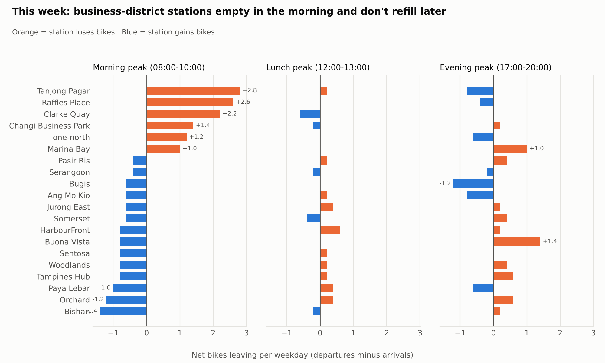
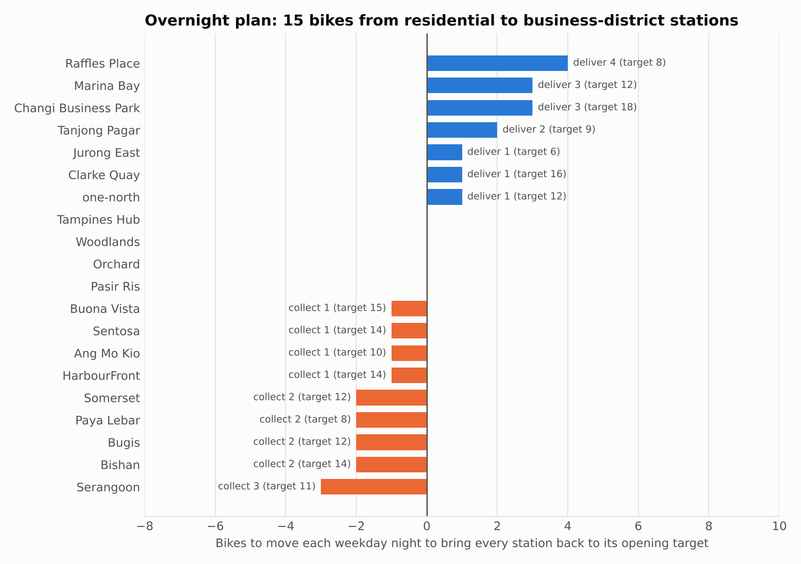
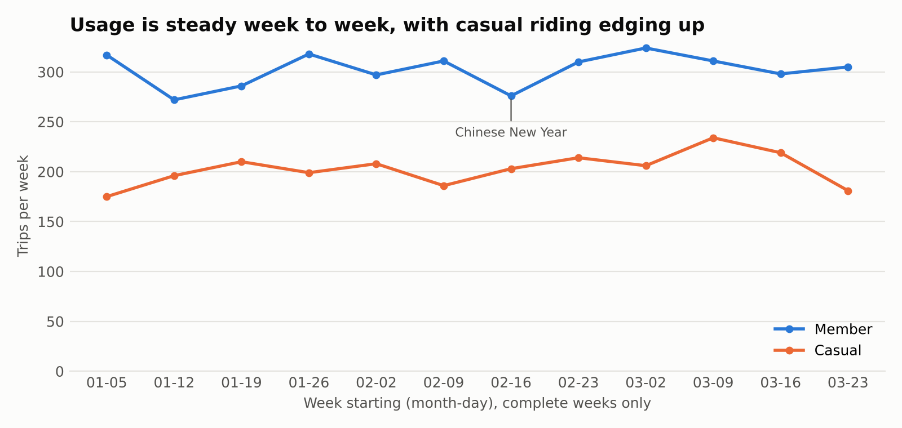
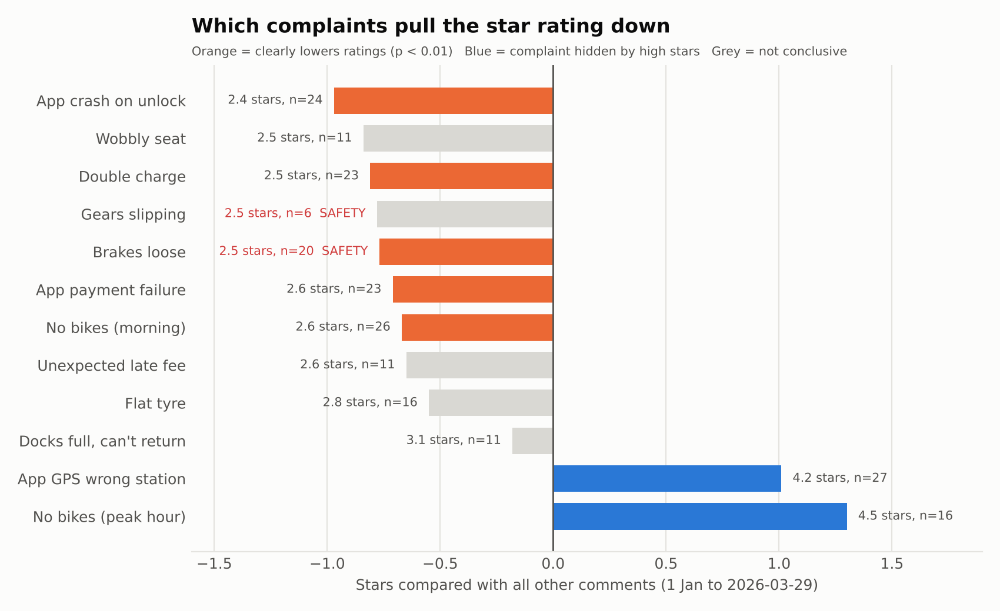

# CityCycle weekly operations report · 23–29 March 2026 · DRAFT

**Headline:** Riders took 486 trips (69.4 a day), 8.1% below the previous four-week average of 529.0 but inside the normal weekly range (468 to 545). Business-district stations again lost bikes every weekday morning. Rebalancing overnight to each station's opening target was enough: no rider found an empty station or a full dock. No safety complaints this week.

## 1. Peak hours (approved and re-checked)

The peaks detected this run match the approved windows: 08:00–10:00, 12:00–13:00 and 17:00–20:00 on weekdays. 08:00 was the busiest morning hour in 10 of the last 12 complete weeks, and 18:00 the busiest evening hour in 11 of 12. Together the peaks carry 71.8% of weekday trips. Weekends have no commuter peak; the busiest slot is 13:30–14:00.

## 2. Where bikes run out

Net bikes lost per weekday in the morning peak: Tanjong Pagar 2.8, Raffles Place 2.6, Clarke Quay 2.2, Changi Business Park 1.4, one-north 1.2, Marina Bay 1.0. The evening peak does not reverse this: every station stayed between -1.2 and 1.4.

## 3. Rebalancing plan for next week: overnight, at the end of each day

| Rule tested on this week | Riders turned away | Bikes moved per day |
|---|---|---|
| Open every station full | 224 (no free dock) | 16.0 |
| Open at target, overnight only | 0 | 22.0 |
| Open at target, overnight + 11:00 run | 0 | 30.0 |

**Recommendation:** rebalance overnight only. A midday run moves more bikes and turns away no fewer riders.

Each weekday night, deliver to Raffles Place 4, Changi Business Park 3, Marina Bay 3, Tanjong Pagar 2, and Jurong East, one-north and Clarke Quay 1 each (15 bikes). Collect from Serangoon 3; Ang Mo Kio, Bishan, Bugis, Paya Lebar and Somerset 2 each; Sentosa and HarbourFront 1 each. Suggested pairings: Serangoon → Raffles Place 3; Bugis → Changi Business Park 2; Paya Lebar → Marina Bay 2; the rest 1 bike each (see rebalancing_transfers.csv). Weekend nights need 11 bikes moved.

**Opening targets for next week:** Raffles Place 8, Tanjong Pagar 9, Marina Bay 12, one-north 12, Clarke Quay 16, Changi Business Park 18 (all 20 stations in rebalancing_plan.csv).

**Watch list:** Raffles Place reached empty on one day without turning a rider away. If it happens on 2 or more days next week, raise its target.

## 4. Busiest stations

Changi Business Park 42 trips, Tanjong Pagar 39, Marina Bay 39, Raffles Place 35, Woodlands 33. Members made 62.8% of trips, averaging 14.3 minutes; casual riders averaged 21.2 minutes.

## 5. What riders are saying

21 comments: 14 negative and 7 positive by their text, average rating 4.0. Top issues: App GPS shows the wrong station 4, no bikes in the morning 3, wobbly seat 2, hard to find a bike at peak hour 2, double charge 2. **Rating watch list** (complaint types that clearly lower star ratings, 1 January to 29 March): app crashes on unlock 2.38 stars, double charges 2.52, loose brakes 2.55, app payment failures 2.61 and morning shortages 2.65. This week brought 3 morning-shortage, 2 double-charge and 1 payment-failure complaints. GPS errors (4.19 stars) and peak-hour shortages (4.5) barely affect ratings, so they are tracked from the text. **Review trigger:** the rating pattern changed this week, because app payment failures joined the rating watch list and wobbly seats left it, so the analyst reviews these two complaint types before sign-off. **Safety:** no brake or gear complaints this week; 26 so far this quarter (20 brakes, 6 gears), each escalated to maintenance on the day it arrived.

## 6. Data caveats

- 10 comments have a star rating that contradicts their text. They are logged in needs_review.csv but not reviewed one by one, because sentiment comes from the text and stars give severity, so nothing is rejected.
- The station region field doesn't match location for 14 stations, so no regional breakdown is given.
- Distance is approximate, so transfers are paired by size, not by route; the ops team plans the route.
- Rebalancing moves are not recorded in the data; the plan assumes each station is reset to its target overnight.

*Prepared automatically from facts.json · Checked by verify_report.py and independent_check.py · Reviewed by: ________ · Approved by: ________*
